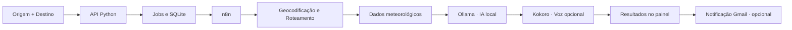

# SmartRoute AI
### Inteligência aplicada à mobilidade, análise de rotas e automação

**Uma plataforma que transforma o planejamento de trajetos em uma experiência inteligente, conectada e automatizada.**

O **SmartRoute AI** combina geolocalização, roteamento, dados meteorológicos, inteligência artificial local e automação de processos em uma interface web. Basta informar origem e destino para acompanhar o processamento da rota, explorar o mapa interativo, consultar métricas e obter um briefing contextualizado da viagem. A plataforma também oferece síntese de voz e notificações automatizadas por e-mail.

O objetivo é mostrar como diferentes tecnologias podem trabalhar de forma integrada para transformar informações dispersas em uma experiência única — da consulta à entrega dos resultados.

---

## Visão geral

| Recurso | O que entrega |
| :-- | :-- |
| **Rotas inteligentes** | Localização de origem e destino, traçado no mapa e estimativas de distância e duração |
| **Informações meteorológicas** | Consulta de condições climáticas relacionadas ao destino |
| **Análise com IA** | Briefing textual contextualizado por meio de modelos executados localmente com Ollama |
| **Experiência em áudio** | Geração opcional de narração via Kokoro TTS |
| **Automação de ponta a ponta** | Orquestração de consultas, análises e integrações por meio do n8n |
| **Notificações por Gmail** | Entrega de resumos e áudio quando o envio está habilitado e autorizado |
| **Acompanhamento em tempo real** | Status de jobs, progresso do processamento e situação das entregas |
| **Histórico e persistência** | Registro das análises e de seus estados em banco de dados SQLite |
| **Diagnóstico operacional** | Verificação dos serviços e mecanismos de observabilidade |

## Como funciona



A solução foi estruturada em camadas independentes: a interface apresenta o mapa e os indicadores; o backend gerencia requisições, execução assíncrona e persistência; o n8n integra os serviços; e os componentes de IA e voz enriquecem o resultado. O processo de notificações utiliza uma **outbox persistente**, com rastreamento dos estados de entrega e proteção contra reprocessamentos indevidos.

## Tecnologias

| Camada | Tecnologias |
| :-- | :-- |
| Frontend | HTML, CSS, JavaScript e Leaflet |
| Backend | Python e API HTTP |
| Banco de dados | SQLite |
| Orquestração | n8n |
| Inteligência artificial | Ollama |
| Síntese de voz | Kokoro TTS |
| Geolocalização e mapas | OpenStreetMap, Nominatim e Leaflet |
| Roteamento | OSRM |
| Meteorologia | Open-Meteo |
| Comunicação | Gmail via SMTP |
| Qualidade | `unittest`, verificação de publicação e testes de carga isolados |

## Destaques de engenharia

**Arquitetura assíncrona.** Operações potencialmente demoradas são acompanhadas como jobs, com estados de execução, limite de concorrência e tratamento de erros.

**Confiabilidade nas integrações.** Persistência SQLite, migrations, idempotência, políticas de retry e estados de envio reduzem riscos de duplicidade e facilitam recuperação de falhas.

**IA local.** O briefing é gerado em uma instância local do Ollama, permitindo separar o processamento inteligente das APIs públicas de geocodificação, clima e rotas.

**Segurança por padrão.** Serviço HTTP limitado ao loopback, tokens para chamadas internas e envios reais desabilitados por padrão. Credenciais, bancos pessoais e logs não fazem parte do código público.

**Testabilidade.** Testes automatizados e laboratório de carga com mocks permitem avaliar a lógica sem acionar Gmail ou APIs públicas durante a execução dos testes.

## Estrutura do projeto

```text
SmartRoute-AI/
├── backend/             # API, jobs, persistência e serviços
│   ├── migrations/      # Evolução do banco SQLite
│   └── services/        # Rotas, clima, geocoding, IA e voz
├── frontend/            # Interface e mapa interativo
├── n8n/                 # Workflow de orquestração
├── runtime/kokoro/      # Componentes de síntese de voz
├── config/              # Configurações de provedores e exemplos
├── scripts/             # Inicialização, diagnóstico e manutenção
├── tests/               # Testes automatizados
├── docs/                # Documentação técnica e validações
├── .env.example         # Exemplo de configuração local
└── run.py               # Entrada da API Python
```

## Executando localmente

**Pré-requisitos:** Python, n8n e, para a experiência completa, Ollama e Kokoro configurados. A consulta a mapas, clima e rotas utiliza serviços externos que exigem conexão com a internet.

```bash
git clone https://github.com/ryanfillip194-design/SmartRoute-AI.git
cd SmartRoute-AI
cp .env.example .env
python run.py
```

No Windows, também há scripts `.bat` de inicialização e diagnóstico. Após iniciar a aplicação, acesse **http://127.0.0.1:8008**.

Para habilitar a orquestração, importe `n8n/SmartRoute_GMAIL_UNIFICADO.json` na instalação local do n8n e configure os serviços e tokens necessários. Para proteger destinatários e contas, o envio real de notificações permanece desabilitado inicialmente (`SMARTROUTE_NOTIFICATION_DRY_RUN=true`).

**Testes automatizados:**

```bash
python -m unittest discover -s tests -v
```

> O código é disponibilizado para execução local e estudo da arquitetura. A instalação de modelos, credenciais SMTP e serviços externos é feita separadamente. O projeto não é um serviço web público hospedado.

## Evolução e próximos passos

O SmartRoute AI foi construído de maneira incremental, integrando primeiro o motor de rotas e a visualização, depois processamento assíncrono, persistência, automação inteligente e comunicação. A arquitetura oferece espaço para evoluções em provedores, análises e canais de notificação, mediante implementação e validação específicas.

---

**SmartRoute AI** · Engenharia de software, inteligência artificial aplicada e integração de sistemas  
**Desenvolvimento:** [Ryan Fillip Costa](https://github.com/ryanfillip194-design)
